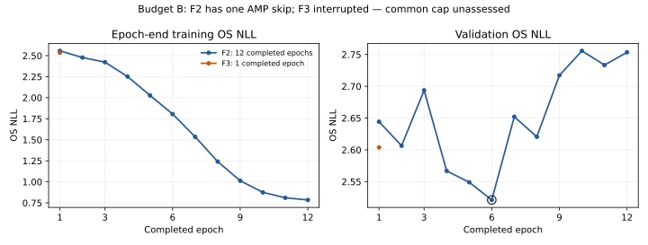

# Budget-B assessment and recovery — October 28, 2026

**The common training cap remains unassessed.** F2 completed twelve epochs but
lost one optimizer update to AMP overflow. F3 was terminated by signal 15 after
one completed epoch. The exact Job and its deleting Pod were still present at
**October 28, 2026, 3:24:06 PM CDT**, after administrator cleanup was reported.
No replacement GPU allocation or repeated deletion has been issued.

This report supersedes the active-training observation in the earlier
[production-path handoff](production_path_20261028.md). That fixture's pass is
preserved; two fabricated updates did not establish sustained real-cohort health.

## Traces, updates and budget decision

| Evidence | F2 | F3 |
| --- | --- | --- |
| Complete epoch rows | 12/12 | 1/12 |
| Planned twelve-epoch optimizer opportunities | 552 | 552 |
| Complete-epoch reported attempts / successes / skips | 552 / 551 / 1 | 46 / 46 / 0 |
| Required finite checkpoint-state audit | Passed for best and last | Not run |
| Previous-window median validation NLL | 2.5669056739 | Unavailable |
| Recent-window median validation NLL | 2.7334051936 | Unavailable |
| Previous minus recent median | −0.1664995196 | Unavailable |
| Improvement threshold | 0.0025669057 | Unavailable |
| Earliest global validation minimum | Epoch 6 | Not assessable on a complete trace |
| Curve-based extension trigger | Neither trigger | Unassessed |
| Budget disposition | Numerical exposure review required | Interrupted and incomplete |

The [machine-readable assessment](budget_b_assessment_20261028.json) contains
the complete calculations and evidence hashes. The CSVs preserve the collected
bytes: [F2](results/budget_b_F2_metrics.csv) and
[F3 partial trace](results/budget_b_F3_partial_metrics.csv). The qualifier's two
fabricated updates per mode are excluded from these real-training counts.

F2's epoch-1 telemetry records one nonfinite-gradient update and one AMP skip.
Epochs 2–12 contain no additional skips. The saved scale is 32,768 after the
initial 65,536 setting. At the selected epoch-6 checkpoint, named OS/shared-head
and backbone Adam counters are 275; at the last checkpoint they are 551. The
checkpoint audit independently reconstructs the actual parameter mapping and
finds finite state. Both checkpoints contain **307,566,600 trainable parameters**
and approved clinical tokens of dimension **29**. These are real-cohort model
observations, distinct from the fabricated qualifier's dimensions.

Selection chose the first minimum validation NLL, **2.5212193895 at epoch 6**,
using `best.pt`. The best and last audit each checked 585 model tensors and
1,584 optimizer tensors, with 528 optimizer states. A finite reconstruction and
correct selection do not make the missing update acceptable budget exposure.
The saved finite-state audit remains valid within that scope.

F3's retained log reaches epoch 2, batch 365/365, but has no complete epoch-2
summary or subsequent checkpoint audit. Its final partial update, evaluation,
save and total successful count are unproven. Those partial-epoch updates are
neither credited to a completed fit nor reported as zero. There is no full
F3 curve on which to apply the median rule.

**Decision: unresolved execution and numerical exposure.** F2's curve alone
does not trigger extension, but the pair supports neither acceptance of twelve
epochs nor a fresh 24-epoch extension. No acceptable-skip tolerance is added
after observing this run. The 0.005 scientific IBS margin has no role here.

## Measured runtime and lifecycle

F2's scoped training-plus-training-evaluation-plus-validation epoch times range
from **172.00 to 199.07 seconds**, with median **176.39 seconds**. Their sum is
2,136.87 seconds; the trainer stage lasted 2,245.00 seconds. The remaining
108.13 seconds combine work outside that timer, including setup, checkpoint I/O
and finalization; they are not separately measured initialization time. The
F3 stage lasted 401.75 seconds before signal 15 and supplies no complete
paired throughput estimate.

Job `trifusesurv2-budget-development-20261028b`, UID
`8cc49447-6372-4d6b-8edf-199db3904cfd`, retains source `3298bf0` and its original
configuration. It finished its worker failure receipt at **2:28:18 PM CDT**.
The later Pod condition reports `DeletionByTaintManager` due to a NoExecute
taint. Available evidence does not identify the sender of signal 15 or prove
that the subsequent taint event caused that signal. The Job later reported
`BackoffLimitExceeded` under its zero-retry contract.

Foreground Job deletion was accepted at **2:34:06 PM CDT**. The Pod has a
**2:35:02 PM CDT** deletion timestamp. Its retained phase was still Running,
although it was not Ready. The supervisor's bounded cleanup reconciliation
failed to establish absence and recorded attention. Its failed cleanup receipt
is preserved. After the user's cleanup confirmation, two fresh exact reads at
3:24:06 PM CDT still found that Job and one UID-owned Pod. The new reconciliation
receipt SHA-256 is
`36399bb86f43af415d7482b5004f3f809c2353f0a43e5a7ab2d5c05dced29ebc`.

Ready occupancy is zero, while the retained worker conservatively continues
to occupy the one-H100 allowance. No finalizer has been removed, no force
deletion has been attempted, and no new Job has been allocated. Worker
termination or safe fencing, exact resource absence and old-controller
reconciliation remain release requirements. There is no defensible recovery ETA.
Project outputs, checkpoints and all collected failure evidence remain in place.

## Prospective source correction and next run

The new optional trainer argument `--amp_init_scale` makes an explicitly chosen
initial scale effective in the actual trainer and its survival-path qualifier.
`None` keeps the existing PyTorch default and legacy contract shape. A positive
explicit value is validated before CUDA setup and retained as an immutable
experiment/checkpoint setting. The qualifier's `trainer-default` path reads that
bound setting; a diagnostic CLI override cannot silently substitute for it.
The performance log now reports effective CUDA matmul TF32, cuDNN TF32 and
float32 matmul precision getters without changing their configuration.

The [candidate numerical policy](../configs/production_numerical_policy_v2_candidate.json)
proposes **FP16 with initial scale 32,768**, retaining the growth/backoff factors,
accumulation, clipping and other settings. F2's observed backoff and later finite
updates motivate this candidate; they do not prove that it fixes the skipped
case or qualifies another run. The [candidate budget specification](../configs/budget_development_v2_candidate_spec.json)
therefore requires a fresh source-bound full H100 qualifier and **fresh F2 and
F3**, each twelve epochs with `T_max=12` and seed 42, after the release gates
close. Neither historical F2 nor partial F3 is pooled as a new-policy fit.

The affected source/configuration/legacy-contract paths passed **59 fabricated
CPU tests and 91 subtests**. There is no new-policy H100 pass yet. The new
operational validators must check the explicitly bound 32,768 scaler policy;
the old helpers' fixed 65,536 expectation is unsuitable for that new attempt.
The normal budget rule applies only after the new pair has complete numerical
and update-exposure evidence. No automatic retry or longer schedule is inferred
from this failure.

Exact stochastic resume is also unsupported by the current checkpoint format:
it saves model, optimizer, scaler, scheduler and encoders, but not all RNG,
loader-generator, worker or batch-cursor state. A CSV row is appended before
the corresponding atomic checkpoint save. The prospective replacement thus
starts both modes fresh and preserves the interrupted compute as history.

## Parallel deliverables

The [replacement baseline candidate](baseline_candidate_b_20261028.md) binds
the corrected reader, unchanged statistical recipe and byte-verified inputs.
Its 4,862 development clinical cells match the source. It remains unreleased
until budget acceptance and the principal freeze; no C0/C1 fit has run.

The [mismatched-routing specification](mismatched_routing_study.md) fixes one
deterministic availability-matched control and three later fits. Development
coverage is 353/442 patients and 1,408/1,497 active regional edges; 89 singleton
cases retain identity routing. All 256 discrete availability combinations pass
its feasibility checks. Actual runtime-mask/parameter parity and numerical
qualification remain required before those fits.

The [principal-freeze checklist](principal_freeze_checklist.md) records the
remaining bindings with the cap unresolved. C0/C1 and all six fresh substantive
F2/F3 fits still follow that freeze. No test scoring, principal comparison,
adequate cap or F3 benefit is established by budget B.
